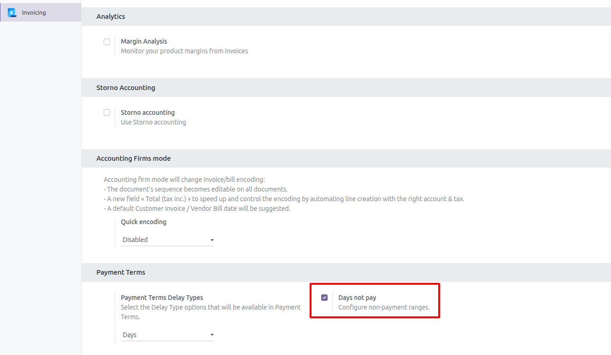
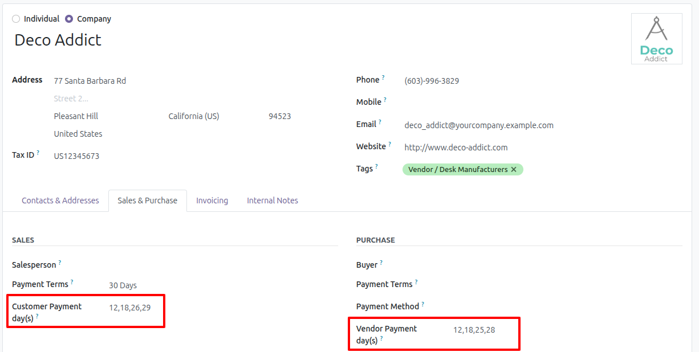
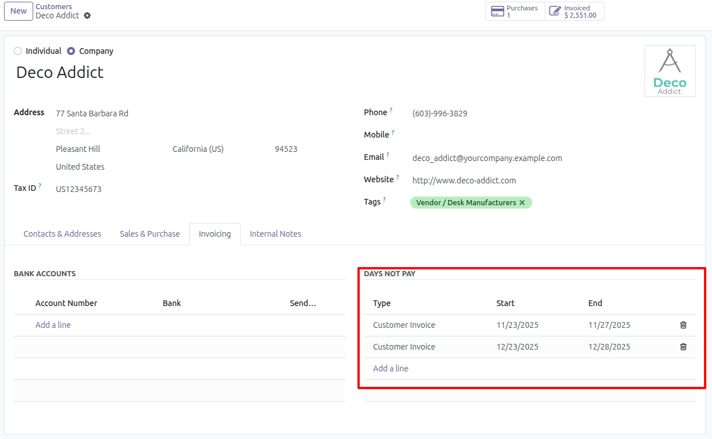
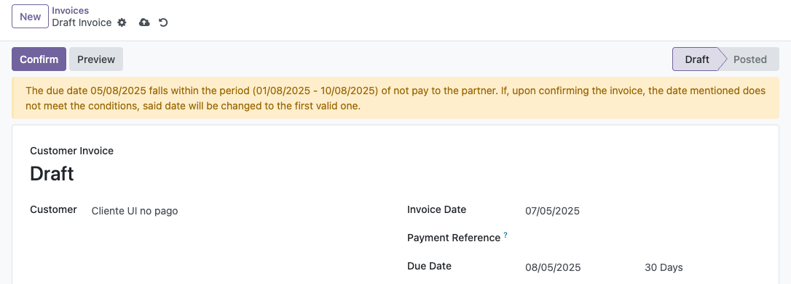

=======================================
Payment Term - Partner Not Payment Days
=======================================

.. 
   !!!!!!!!!!!!!!!!!!!!!!!!!!!!!!!!!!!!!!!!!!!!!!!!!!!!
   !! This file is generated by oca-gen-addon-readme !!
   !! changes will be overwritten.                   !!
   !!!!!!!!!!!!!!!!!!!!!!!!!!!!!!!!!!!!!!!!!!!!!!!!!!!!
   !! source digest: sha256:150e48e380df2df5d2435713f6d0dd9cedcbac8398e7dbed82539c00bab89d50
   !!!!!!!!!!!!!!!!!!!!!!!!!!!!!!!!!!!!!!!!!!!!!!!!!!!!

.. |badge1| image:: https://img.shields.io/badge/maturity-Beta-yellow.png
    :target: https://odoo-community.org/page/development-status
    :alt: Beta
.. |badge2| image:: https://img.shields.io/badge/licence-AGPL--3-blue.png
    :target: http://www.gnu.org/licenses/agpl-3.0-standalone.html
    :alt: License: AGPL-3
.. |badge3| image:: https://img.shields.io/badge/github-OCA%2Faccount--payment-lightgray.png?logo=github
    :target: https://github.com/OCA/account-payment/tree/17.0/account_payment_term_partner_not_paydays
    :alt: OCA/account-payment
.. |badge4| image:: https://img.shields.io/badge/weblate-Translate%20me-F47D42.png
    :target: https://translation.odoo-community.org/projects/account-payment-17-0/account-payment-17-0-account_payment_term_partner_not_paydays
    :alt: Translate me on Weblate
.. |badge5| image:: https://img.shields.io/badge/runboat-Try%20me-875A7B.png
    :target: https://runboat.odoo-community.org/builds?repo=OCA/account-payment&target_branch=17.0
    :alt: Try me on Runboat

|badge1| |badge2| |badge3| |badge4| |badge5|

There may be a scenario where you don't want to make a payment to a
partner, whether due to vacation, an unofficial agreement, or other
reasons.

This module allows you to automate these scenarios by defining
non-payment date ranges for each partner and calculating the due date
based on those defined ranges and the initial payment terms.

**Table of contents**

.. contents::
   :local:

Use Cases / Context
===================

Some partners do not pay, or are not paid, during certain periods, such
as holidays or a closing period agreed with them. This module keeps
those periods on the partner, per type of document, and moves the due
date out of them when the invoice is posted, using the partner's payment
days from Payment Term - Partner Payment Days
(account_payment_term_partner_paydays).

Configuration
=============

Enable non-payment ranges
-------------------------

1. Go to Invoicing > Configuration > Settings > Payment Terms

2. Enable the option "Days not pay"

3. Save

   |Enable day not pay|

Usage
=====

Set payment days per customer or vendor
---------------------------------------

1. Go to Invoicing > Customers > Customers

2. Select or create a new partner

3. Go to tab "Sales & Purchase"

4. In section "Sales", enter the payment days separated by commas (,),
   dashes (-) or spaces ( ) in field "Customer Payment day(s)". Example:
   12,18,26,29

   For vendor bills, vendor credit notes and purchase receipts, enter
   them in field "Vendor Payment day(s)" of section "Purchase".

   |Partner days pay|

5. Save

Add range not pay to partner
----------------------------

1. Go to Invoicing > Customers > Customers

2. Select or create a new partner

3. Go to tab "Invoicing", section "Days not pay"

4. Add a line for each range with the type of document it applies to
   (Customer Invoice, Customer Credit Note, Vendor Bill, Vendor Credit
   Note, Sales Receipt or Purchase Receipt), its Start and its End.
   Ranges of the same type cannot overlap; ranges of different types
   can.

5. Save

   |Partner days not pay|

Only Billing Administrators can add or change the ranges. Other users
with access to invoicing can see them.

Create invoice with partner configured for non-payment days
-----------------------------------------------------------

1. Go to Invoicing > Customers > Invoices

2. Create a new invoice and select a partner that has non-payment
   ranges.

3. If the due date falls within one of the partner's ranges for that
   type of document, a warning is displayed at the top of the form and
   the due date is shown next to the payment terms.

   |Invoice due date not valid|

4. Confirm the invoice. Each installment whose due date falls within a
   range is moved to a valid date, and the installments outside the
   ranges keep theirs. The due date of the invoice is then the date of
   its last installment. The same happens when the invoice is posted
   from the "Post entries" action of the list view or by the "Auto-post"
   option.

   A due date entered by hand is used only when the invoice has no
   payment terms. With payment terms, the due date is always computed
   from them.

   The valid date is computed as follows:

   1. Month by month, starting with the month of the due date, the
      partner's payment days on or after the day of the due date are
      tried, and the first date later than the due date and outside
      every range is used. If none of the payment days is on or after
      that day, all of them are tried.

   2. If the partner has no payment days, the day of the due date is
      kept, in the first following month where that date is outside
      every range.

   A payment day that does not exist in a month, such as the 31st,
   becomes the last day of that month.

   Example:

   - Partner payment days: 5, 17
   - Payment terms: 30 Days
   - Non-payment range: 8/1/2025 - 8/31/2025 (Customer Invoice)
   - Invoice date: 7/15/2025

   The payment terms and the payment days give a due date of 8/17/2025,
   which falls within the range. When the invoice is confirmed, the due
   date changes to 9/17/2025: 17 is the only payment day on or after the
   17th, and September 17 is the first of those dates outside the range.

Credit notes, receipts and vendor bills are adjusted in the same way
when they are posted, with the ranges of their type.

Known issues / Roadmap
======================

- On a draft invoice, when the payment terms are set before adding any
  line, the due date shown is not updated from the payment terms, so the
  warning is not displayed. The due date is checked again when the
  invoice is confirmed.

Bug Tracker
===========

Bugs are tracked on `GitHub Issues <https://github.com/OCA/account-payment/issues>`_.
In case of trouble, please check there if your issue has already been reported.
If you spotted it first, help us to smash it by providing a detailed and welcomed
`feedback <https://github.com/OCA/account-payment/issues/new?body=module:%20account_payment_term_partner_not_paydays%0Aversion:%2017.0%0A%0A**Steps%20to%20reproduce**%0A-%20...%0A%0A**Current%20behavior**%0A%0A**Expected%20behavior**>`_.

Do not contact contributors directly about support or help with technical issues.

Credits
=======

Authors
-------

* Binhex

Contributors
------------

- `Binhex <https://www.binhex.cloud>`__:

  - Edilio Escalona Almira e.escalona@binhex.cloud

Maintainers
-----------

This module is maintained by the OCA.

.. image:: https://odoo-community.org/logo.png
   :alt: Odoo Community Association
   :target: https://odoo-community.org

OCA, or the Odoo Community Association, is a nonprofit organization whose
mission is to support the collaborative development of Odoo features and
promote its widespread use.

This module is part of the `OCA/account-payment <https://github.com/OCA/account-payment/tree/17.0/account_payment_term_partner_not_paydays>`_ project on GitHub.

You are welcome to contribute. To learn how please visit https://odoo-community.org/page/Contribute.
