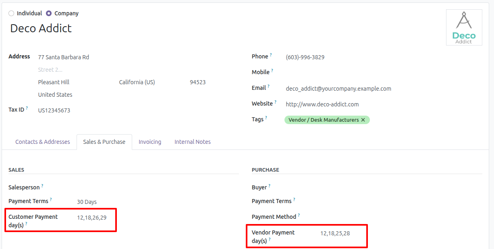
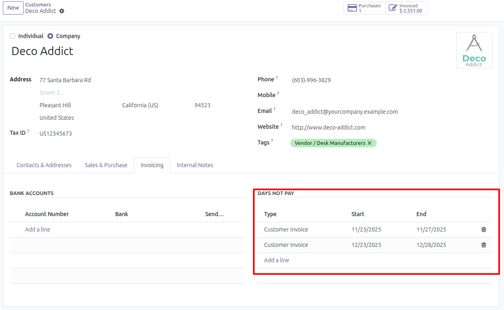
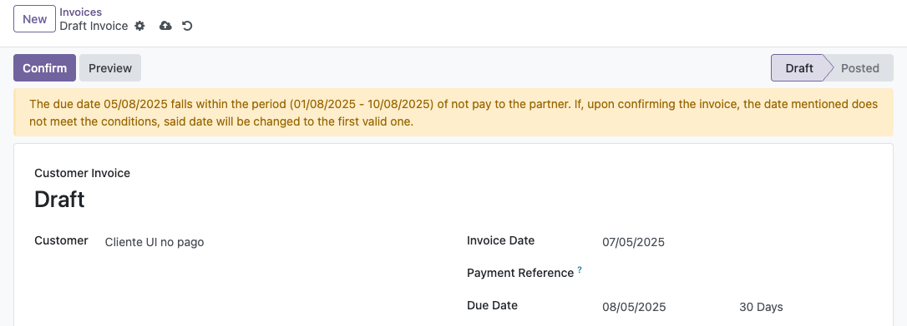

Set payment days per customer or vendor
---------------------------------------

1. Go to Invoicing > Customers > Customers
2. Select or create a new partner
3. Go to tab "Sales & Purchase"
4. In section "Sales", enter the payment days separated by commas (,), dashes (-) or
   spaces ( ) in field "Customer Payment day(s)". Example: 12,18,26,29

   For vendor bills, vendor credit notes and purchase receipts, enter them in field
   "Vendor Payment day(s)" of section "Purchase".

   

5. Save

Add range not pay to partner
------------------------------

1. Go to Invoicing > Customers > Customers
2. Select or create a new partner
3. Go to tab "Invoicing", section "Days not pay"
4. Add a line for each range with the type of document it applies to (Customer
   Invoice, Customer Credit Note, Vendor Bill, Vendor Credit Note, Sales Receipt or
   Purchase Receipt), its Start and its End. Ranges of the same type cannot overlap;
   ranges of different types can.
5. Save

   

Only Billing Administrators can add or change the ranges. Other users with access to
invoicing can see them.

Create invoice with partner configured for non-payment days
--------------------------------------------

1. Go to Invoicing > Customers > Invoices
2. Create a new invoice and select a partner that has non-payment ranges.
3. If the due date falls within one of the partner's ranges for that type of document,
   a warning is displayed at the top of the form and the due date is shown next to the
   payment terms.

   

4. Confirm the invoice. Each installment whose due date falls within a range is moved
   to a valid date, and the installments outside the ranges keep theirs. The due date
   of the invoice is then the date of its last installment. The same happens when the
   invoice is posted from the "Post entries" action of the list view or by the
   "Auto-post" option.

   A due date entered by hand is used only when the invoice has no payment terms. With
   payment terms, the due date is always computed from them.

   The valid date is computed as follows:

   1. Month by month, starting with the month of the due date, the partner's payment
      days on or after the day of the due date are tried, and the first date later
      than the due date and outside every range is used. If none of the payment days
      is on or after that day, all of them are tried.

   2. If the partner has no payment days, the day of the due date is kept, in the first
      following month where that date is outside every range.

   A payment day that does not exist in a month, such as the 31st, becomes the last day
   of that month.

   Example:

   - Partner payment days: 5, 17
   - Payment terms: 30 Days
   - Non-payment range: 8/1/2025 - 8/31/2025 (Customer Invoice)
   - Invoice date: 7/15/2025

   The payment terms and the payment days give a due date of 8/17/2025, which falls
   within the range. When the invoice is confirmed, the due date changes to 9/17/2025:
   17 is the only payment day on or after the 17th, and September 17 is the first of
   those dates outside the range.

Credit notes, receipts and vendor bills are adjusted in the same way when they are
posted, with the ranges of their type.
